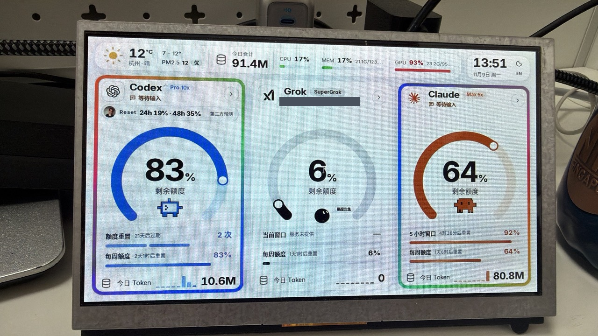
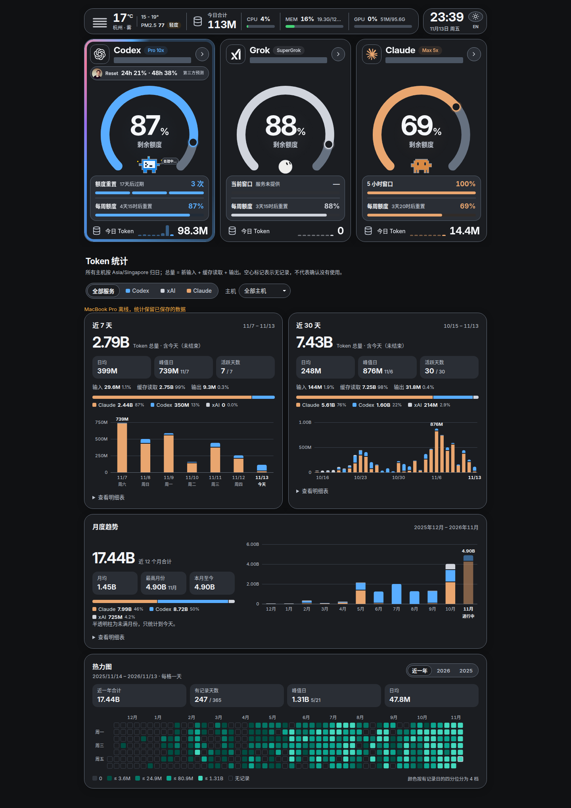

# Quota Deck

面向浏览器和 HDMI 小屏的 AI 额度与用量仪表盘。它把 Codex、Grok 和 Claude 的可用额度、本机与已配置远程主机的 Token 用量，以及任务运行状态放在同一个界面中。

## 实际运行

实体屏照片（账号已遮挡）：



浏览器页面（账号已遮挡）：



截图中的额度和统计值为拍摄时的实际数据，不代表实时状态。

## 功能

- 查看 Codex、Grok、Claude 的额度窗口、重置时间和当日 Token 用量。
- 浏览 7 天、30 天和月度用量趋势及年度热力图；按服务和主机筛选。
- 读取本机以及通过 SSH 配置的远程主机用量和 Agent 状态；完成或等待输入时在卡片上提醒。
- 展示 CPU、内存、NVIDIA GPU 和天气；支持中英文、定时深浅色主题及手动切换。
- 提供局域网遥控页面，适合没有触摸屏、鼠标或键盘的 HDMI 小屏。

额度读取依赖各客户端及其接口，接口或登录状态变化时可能无法获取数据。未知值会显示为未知，不会假设额度为 100%。

## 浏览器运行

需要 Linux、Python 3、Node.js 和 npm。额度功能还需要安装并登录要使用的 CLI；统计功能读取对应用户可访问的本机会话记录。

```bash
git clone https://github.com/tangshunpu/quota-deck.git
cd quota-deck
npm ci
npm run build
python3 server.py --host 127.0.0.1 --port 18768
```

打开 <http://127.0.0.1:18768/>。关闭服务使用 Ctrl+C。没有 NVIDIA GPU 时对应指标会显示为不可用。天气默认使用杭州，其他地区可能需要调整 `weather.py`。

## 局域网遥控

若需要从其他设备访问，可以使用随附的用户级 systemd 服务：

```bash
bash install-web-service.sh
systemctl --user status quota-deck-web
```

在另一台设备访问 `http://<主机IP>:18768/control/`，按照提示输入 `~/.config/quota-deck/remote-key` 中的访问密钥。该服务监听所有网络接口；远程 API 需要密钥，仍应只在可信网络中使用，避免将端口直接暴露到公网。明文 HTTP 不加密传输，跨不可信网络时请使用安全隧道。

卸载用户服务可手动禁用并删除 `~/.config/systemd/user/quota-deck-web.service`，然后执行 `systemctl --user daemon-reload`。

## HDMI 实体屏（Linux）

实体屏启动器需要 Xorg、xrandr、xauth、GTK 3 和 WebKit2GTK 4.1 的 Python 绑定，以及支持的显示硬件。完成前端构建后：

```bash
bash run-quota.sh
```

启动器使用 sudo 创建临时 Xorg 会话，再以普通用户运行面板。需要 systemd 常驻服务时，可运行 `sudo bash install-service.sh`；运行前请阅读脚本，确认其适合你的显示环境。服务名为 `quota-deck`，卸载使用 `sudo bash install-service.sh uninstall`。

## 远程主机

可在 `~/.config/quota-deck/hosts.json` 中配置通过 SSH 访问的主机，例如：

```json
[{"name": "Laptop", "ssh": "user@your-host"}]
```

远程主机需要 SSH 和 Python 3。远程数据采集使用当前用户已有的 SSH 配置，不要求把账户凭据复制到面板主机。务必只配置你信任且有权访问的主机。

## 数据与隐私

- 面板读取已有的 CLI 登录信息及会话日志，以获取额度、用量和任务状态；适配器可能调用供应商的额度接口。请先阅读 `providers.py`、`tokens.py` 和远程采集代码，确认其行为符合你的需要。
- 历史统计存于 `~/.local/share/quota-deck/`，配置和遥控密钥存于 `~/.config/quota-deck/`，缓存存于 `~/.cache/quota-deck/`。这些文件不属于源码仓库。
- 截图、日志和配置可能包含账号、主机名或用量等私人数据；公开分享前请检查并遮挡。

## 开发与验证

```bash
npm ci
npm run build
python3 -m unittest discover -p 'test_*.py'
node --test test_theme.mjs test_i18n.mjs test_reset_signals.mjs
```

前端使用 React 和 Vite，后端使用 Python 标准库。浏览器页面和实体屏共用仪表组件；浏览器页面额外显示统计视图。

## 许可与第三方资源

项目代码以 [MIT License](LICENSE) 发布。字体 Inter 的许可证见 `public/fonts/Inter-LICENSE.txt`；品牌 SVG 来源及许可证见 `public/logos/`。各品牌和商标归其所有者所有。本项目与这些品牌无隶属关系。
